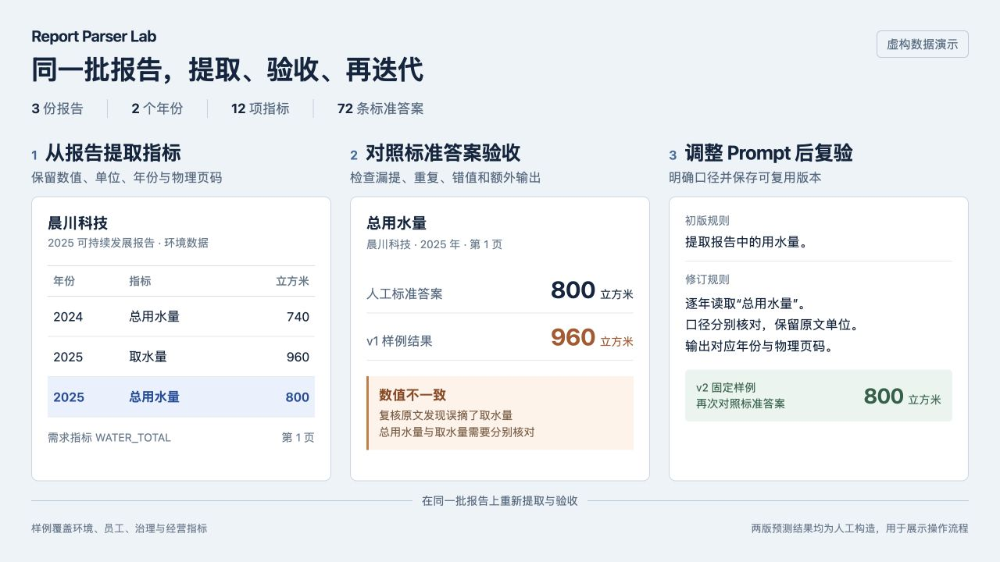
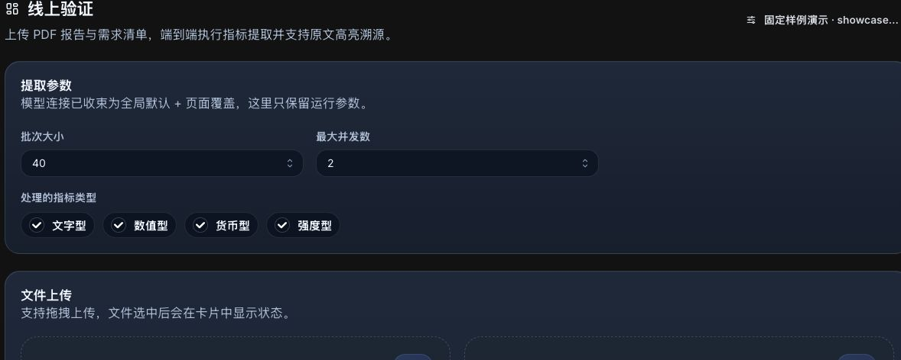
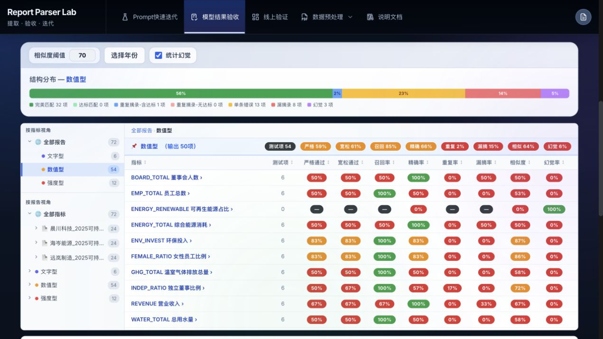
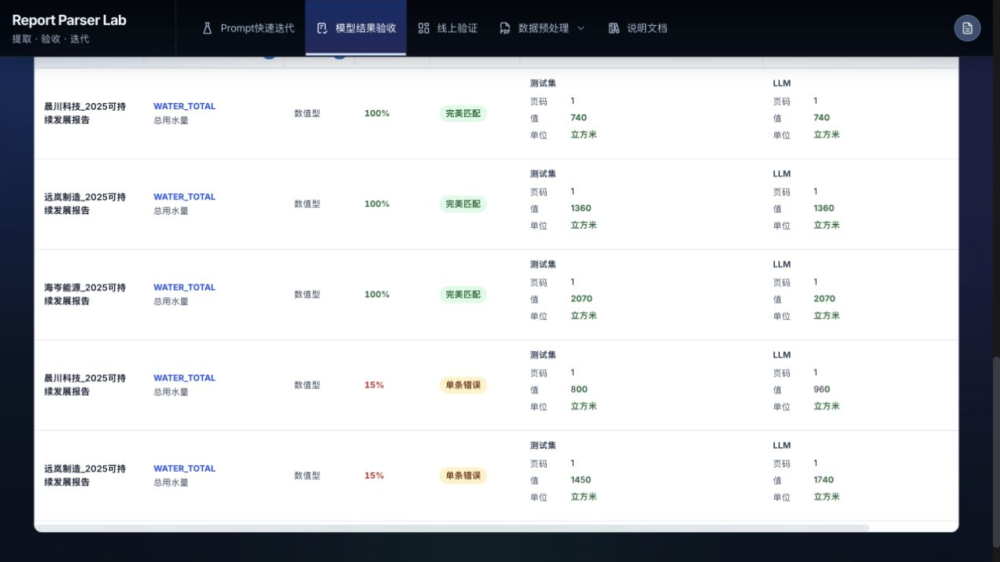
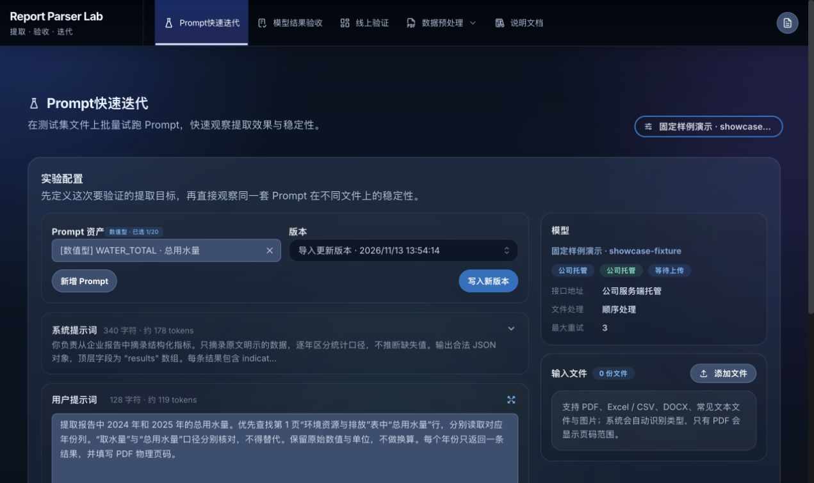

# Report Parser Lab

**报告数据提取、结果验收与 Prompt 迭代工作台。**

面向需要反复处理企业报告的开发者、数据分析与质量验收人员，Report Parser Lab 把指标摘录、标准答案对照和 Prompt 版本管理放在同一个浏览器工作台里。上传报告和指标需求，获得带年份、单位、来源页码的结构化结果，再根据验收明细调整 Prompt、重新试跑。

[快速开始](#快速开始) · [完整演示数据](docs/examples/showcase/README.md) · [数据格式](docs/getting-started.md) · [部署指南](docs/deployment.md)



演示使用虚构公司、报告和人工构造的预测结果。两版结果用于复现错误分析与迭代流程，样例验收统计由项目现有规则计算。

## 从报告到可以复核的数据

### 提取指标，保留年份、单位与来源

上传多份 PDF 和指标需求表，或选择已保存的 Prompt 资产，按文字、数值、货币、强度四类指标批量提取。结果表保留来源文件、指标代码、年份、值、单位和 PDF 物理页码，可导出 Excel。

演示包含三家虚构公司的报告，每份同时披露 2024、2025 年数据。环境、员工、治理和经营指标使用同一套字段，便于按报告和年份查看结果。



### 对照人工答案，定位漏提、重复与错值

将预测结果和人工标准答案导入「模型结果验收」，按报告、指标和年份关联。通过报告树、指标类型、错误分类和明细表，检查漏提、重复、额外输出，以及数值、单位和页码的差异。验收在浏览器本地执行，无需 API Key，也可导入其他程序生成的 Excel/CSV。

演示数据保留了多种问题，既有完全匹配的行，也有跨年误摘、口径混淆、单位错误和重复结果。读者可以下载同一批文件，复现截图中的分析。



验收明细可以继续下钻到单个指标，查看人工答案、模型值、单位、页码和错误分类。



### 根据错误调整 Prompt，再用同样本复验

在「Prompt快速迭代」中编辑系统提示词和用户提示词，试跑多个文件，检查原始回复、JSON 解析状态、耗时和 Token。经过复核的 Prompt 可以按指标保存版本，供后续试跑与批量提取复用。

下面以晨川科技报告中的「总用水量」为例。报告第 1 页同时列出两个年份，并区分取水量与总用水量。

| 对照内容 | 数值与年份 | 用来检查什么 |
| --- | --- | --- |
| 原文中的总用水量 | 800 立方米 | 目标指标的人工标准答案 |
| 原文中的取水量 | 960 立方米 | 名称相近、统计口径不同的干扰项 |
| 原文中的上年总用水量 | 740 立方米（2024 年） | 跨年份表格的取值范围 |
| 人工构造的 v1 结果 | 960 立方米 | 演示误摘取水量后的验收差异 |
| 人工构造的 v2 结果 | 800 立方米 | 演示修订规则后的再次对照 |

为这一指标补充的规则是「逐年读取总用水量，不用取水量代替，不把上年数据填入本年」。演示包提供两版用户提示词及对应预测表，便于检查改动、重新关联并导出结果。



## 下载并复现完整案例

| 演示内容 | 覆盖范围 |
| --- | --- |
| 虚构报告 | 晨川科技、远岚制造、海岑能源，共 3 份 PDF |
| 数据年份 | 每份报告包含 2024、2025 年 |
| 指标 | 每年 12 项，覆盖文字、数值、货币和强度类型 |
| 人工标准答案 | 72 条，包含值、单位、年份与物理页码 |
| 预测结果 | v1、v2 两版人工构造数据，保留可检查的错误与差异 |
| Prompt | 可导入的指标资产和总用水量迭代示例 |

进入「模型结果验收」，上传演示包中的预测结果与标准答案，使用默认关联字段后开始分析。切换两版结果，查看问题行、分类和导出工作簿。文件清单、数据说明和操作步骤见[完整演示数据](docs/examples/showcase/README.md)。

两版构造预测在相似度阈值为 70 时，得到以下验收结果。

| 样例验收口径 | v1 构造预测 | v2 构造预测 |
| --- | --- | --- |
| 严格通过测试项 | 42 / 72（58.3%） | 65 / 72（90.3%） |
| 漏提测试项 | 8 | 2 |
| 含重复输出的测试项 | 4 | 1 |
| 标准答案之外的输出 | 3 | 1 |

严格通过要求该测试项只有一条输出，且相似度达到阈值。两版预测预先构造了多类差异，用水量案例只解释其中一项指标，表中的全量差异不能归因于这一条 Prompt 的修改。

## 谁适合使用

| 使用者 | 可以完成的工作 |
| --- | --- |
| 文档提取开发者与 Prompt 编写者 | 用多份文件检验 Prompt，检查结构化输出，保存可复用版本 |
| 数据质量与验收人员 | 将模型结果与标准答案关联，筛选问题样本，导出对比和分析数据 |
| ESG、可持续发展与企业报告分析团队 | 按指标需求批量摘录报告，检查数值、单位、年份和来源页码 |
| 内部 AI 工具维护者 | 自行部署网页工作台，集中配置团队模型、页面开关和默认参数 |

项目源自 ESG 报告指标摘录，当前的默认提示词、指标类型和验收字段带有这一场景特点。迁移到其他业务时，需要适配指标定义、输出字段和验收口径。

## 快速开始

准备满足依赖要求的 Node.js **22.13+** 和 npm，无需单独安装数据库。

```bash
git clone https://github.com/xjzc-mt/report-parser-lab.git
cd report-parser-lab
npm install
```

开发模式打开两个终端。

```bash
# 终端 1，后端 API 默认使用 8787 端口，请替换本地管理员密码
ADMIN_PASSWORD='替换为自己的本地密码' npm run dev:server
```

```bash
# 终端 2，前端默认使用 5173 端口
npm run dev
```

打开终端显示的前端地址，通常为 [http://localhost:5173](http://localhost:5173)。管理员入口为 [/admin](http://localhost:5173/admin)，默认用户名为 `admin`。

首次体验可直接导入[完整演示数据](docs/examples/showcase/README.md)完成本地验收，也可使用[两条数据的最小示例](docs/getting-started.md#无需-api-key体验结果验收)。

需要调用模型时，在模型选择弹窗的「配置模型」中填写个人接口地址与 Key，Ping 后选择模型并保存。团队共享连接由管理员在 `/admin` 配置。模型协议、附件能力和单副本部署方式见[部署与模型配置](docs/deployment.md)。

## 其他工具

| 工具 | 用途 | 是否调用模型 |
| --- | --- | --- |
| Chunking测试 | 根据名称和描述定位 PDF 相关页，拆分后打包下载 | 是 |
| PDF压缩 | 调整图片质量、尺寸与灰度，下载压缩文件 | 否 |
| Token统计 | 估算文本、表格和 PDF 文本的输入 Token 与成本 | 否 |

Token 与成本用于预算参考，以所选服务的实际计费为准。Prompt 自动优化保留了诊断、候选生成和验证实现，**默认关闭**，管理员重新开放前需复验评分、取消流程和实际模型调用。

## 数据存储与部署边界

| 数据 | 存储或处理位置 |
| --- | --- |
| 个人模型预设与 Key | 当前浏览器，模型请求由浏览器直连配置的上游 |
| 团队托管连接、Key、页面开关和默认参数 | 服务端配置文件，默认 `server/data/config.json`，Key 不下发前端 |
| Prompt 资产、草稿、部分上传缓存与历史 | 当前浏览器的 `localStorage` / `IndexedDB`，不自动跨设备同步 |
| 线上验证结果、拆分与压缩产物 | 需要导出或下载保存，并非所有页面都保存历史 |
| 用于模型处理的文档内容 | 按任务发送到所选模型服务，可能是原始附件或本地解析后的文本 |

团队托管请求先经过本项目后端，再发送到管理员配置的模型服务。部署入口应配置 HTTPS、用户访问认证和受限的持久化目录，管理员登录只保护后台配置。当前采用单管理员、单副本配置管理，多副本需要另行设计共享配置与会话。

- 扫描 PDF 依赖上游附件能力，文本回退可能无法识别图片中的内容。
- 相似度、错误分类和页面标记的“幻觉”需要结合原文及标注覆盖范围复核，规则分数与事实正确性有不同口径。
- 接口失败也可能呈现“未披露”，应结合运行日志与失败摘要判断。
- 任务由浏览器发起，关闭或刷新后不支持断点续跑，各模块的站内切页和停止行为见页面说明。

## 开发与贡献

前端使用 React、Vite 和 Mantine，后端使用 Node.js 原生 HTTP。PDF 和表格处理主要使用 pdf.js、pdf-lib 和 SheetJS。

| 目录 | 主要职责 |
| --- | --- |
| `src/components/` | Prompt 迭代、结果验收、线上验证与预处理界面 |
| `src/services/` | 文件解析、模型调用、导出、Prompt 资产与持久化 |
| `src/utils/` / `src/constants/` | 计算逻辑、状态规整、默认值和页面开关 |
| `src/admin/` / `server/` | 管理后台、认证、配置存储和公司模型转发 |
| `tests/` | Node 原生测试与服务端 HTTP 集成测试 |
| `docs/examples/` / `requirement/` | 虚构演示数据与现有 ESG 指标需求表 |

欢迎通过 [Issue](https://github.com/xjzc-mt/report-parser-lab/issues) 提供可复现的问题、脱敏样本和业务适配需求，通过 [Pull Request](https://github.com/xjzc-mt/report-parser-lab/pulls) 改进文档、文件兼容性和验证流程。提交前阅读 [AGENTS.md](AGENTS.md)，并执行以下检查。

```bash
npm test
npm run build
git diff --check
```

涉及文件处理或模型调用时，按协作指南验证上传、运行与下载链路。公司模型测试使用假 Key 和模拟上游。调整核心 Prompt、提取白名单、相似度或权重前，先说明方案与影响范围。

`public/conversion.xlsx` 与 `public/synonyms.xlsx` 是单位换算、同义词和相似度的初始化配置，需要保留。请勿提交真实密钥、内部配置、敏感报告或个人浏览器备份。

## 文档与许可证

- [数据格式与最小示例](docs/getting-started.md)
- [部署与模型配置](docs/deployment.md)
- [文档索引与验证记录](docs/README.md)

本项目采用 [ISC 许可证](LICENSE)。
