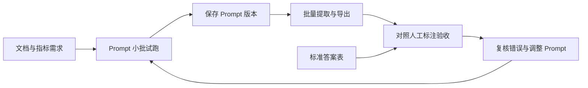

# Report Parser Lab

**报告数据提取、结果验收与 Prompt 迭代工作台。**

Report Parser Lab 帮助你从报告中提取结构化数据，对照人工标注验收结果，再根据误差迭代 Prompt。围绕同一批样本反复验证，让每次调整都有结果可查。

你可以在浏览器中批量试跑 Prompt，把模型结果与人工标注逐项对照，检查数值、单位、年份和来源页码，并保存 Prompt 版本、导出 Excel 分析结果。项目支持本地运行和自行部署，可接入个人模型 API 或团队托管模型。

项目源自 ESG 报告指标摘录场景，当前的指标类型、结果结构和部分默认提示词仍围绕这一场景设计。通用文档可以先使用 Prompt 快速迭代；迁移到其他业务的批量提取与评测，需要适配字段和验收口径。

[快速开始](#快速开始) · [最小示例与数据格式](docs/getting-started.md) · [部署与模型配置](docs/deployment.md) · [文档索引](docs/README.md)


## 谁需要它

| 你正在做的工作 | 常见困扰 | 可以用它完成什么 |
| --- | --- | --- |
| LLM 应用开发、Prompt 调试 | 单份文件效果不错，换一批文件就不稳定 | 用多份文件试跑同一套 Prompt，检查原始回复、JSON 解析结果、耗时和 Token，保存可复用版本 |
| 数据质量、测试与验收 | 模型结果和人工答案分散在 Excel 里，逐行核对费时 | 按报告、指标和年份关联两张表，查看匹配情况、字段相似度、漏提和额外输出，导出分析数据 |
| ESG、可持续发展或企业报告分析 | 需要从多份报告中反复摘录相同指标 | 用 PDF 和指标需求表批量提取文字、数值、货币及强度型指标，整理成带页码的 Excel |
| 负责内部 AI 工具的开发者 | 业务同事需要界面，团队模型凭据需要集中维护 | 自行部署工作台，由管理员配置共享模型、页面开关与默认参数 |

最适合的起点是：你已经有一批文档、想提取的指标，以及少量人工核对过的答案，希望把“凭感觉改 Prompt”变成可以检查结果的迭代过程。部署需要基本的 Node.js 操作；日常上传、试跑和验收通过网页完成。

## 能帮助你完成什么

### 试跑 Prompt，保留可复用版本

在「Prompt快速迭代」中编辑系统提示词和用户提示词，上传 PDF、图片、Excel/CSV、DOCX 或文本文件，逐份查看响应和解析结果。PDF 可指定页码范围；同类型指标可合批试跑，并分别编辑用户提示词。

经过检查的 Prompt 可以保存到资产库，按指标维护版本，供后续试跑和提取复用。文件直传是否可用，取决于模型和接入协议的实际能力。

### 对照人工答案，找到需要修正的结果

在「模型结果验收」中上传模型结果表与人工标注表，配置关联字段，查看报告、指标、类型和页码维度的分析。既可以验收本项目生成的结果，也可以导入其他程序生成、且字段符合要求的 Excel/CSV。

评测在浏览器本地执行，无需模型 API Key。评分使用现有的文本相似度、数值与单位规则及类型权重；它帮助筛选问题样本，**分数不等于事实正确率**。页面标记的“幻觉”也需要结合原文和标注覆盖范围复核。

### 用真实报告验证提取流程

在「线上验证工作台」中上传多份 PDF 和指标需求表，或选择 Prompt 资产作为提取需求，设置指标类型、批次、并发和重试参数，运行后导出结果与摘要。

典型结果包括来源文件、指标、年份、文字或数值、单位、币种和 PDF 页码。这里的“线上验证”指调用实际模型处理文档，不包含生产流量监控或自动发布。

### 准备输入文件，估算调用成本

| 工具 | 用途 | 是否调用模型 |
| --- | --- | --- |
| Chunking测试 | 根据名称与描述定位 PDF 相关页，拆分后打包下载 | 是 |
| PDF压缩 | 调整 PDF 图片质量、尺寸与灰度，下载压缩文件 | 否 |
| Token统计 | 估算文本、表格和 PDF 文本的输入 Token 与成本 | 否 |

Token 与成本均为估算；PDF 直传、多模态输入和不同厂商的实际计费可能不同。

> **实验功能：Prompt自动优化默认关闭。** 源码保留了错误诊断、候选生成与验证流程，管理员可显式开启；重新开放前需要复验评分、取消流程与实际模型调用。

## 一个典型使用过程

假设你需要从多份企业报告中提取“员工总数”和“温室气体排放量”：

1. **明确口径**：写清指标定义、目标年份、统计范围和单位，人工核对少量样本，形成标准答案表。
2. **小批试跑**：在 Prompt 快速迭代中选择几个代表性文件或页码，检查返回结构与内容，保存 Prompt 版本。
3. **批量提取**：在对应需求表或 Prompt 资产准备好后，使用线上验证工作台处理更多 PDF，导出结果。
4. **关联验收**：把模型结果与标准答案导入模型结果验收，按字段关联，筛选低分、未匹配、多结果和额外输出。
5. **修正并复验**：结合原文检查问题，调整 Prompt 或标注，在相同样本和新增样本上重新验证，再保存版本与分析结果。



这些步骤通过文件、Prompt 资产和页面操作衔接。提取导出表与验收表的列名可能不同，首次使用请按[数据格式说明](docs/getting-started.md#接入自己的数据)配置映射。

## 快速开始

准备 Node.js **22.13+**（满足依赖要求的版本）和 npm。完整运行由前端与后端组成，无需单独安装数据库。

```bash
git clone https://github.com/xjzc-mt/report-parser-lab.git
cd report-parser-lab
npm install
```

开发模式打开两个终端：

```bash
# 终端 1：后端 API，默认 8787；请替换为自己的本地管理员密码
ADMIN_PASSWORD='替换为自己的本地密码' npm run dev:server
```

```bash
# 终端 2：前端，默认 5173
npm run dev
```

打开终端显示的前端地址，通常为 [http://localhost:5173](http://localhost:5173)。管理员入口为 [/admin](http://localhost:5173/admin)，默认用户名为 `admin`。

**先体验，无需模型 Key：** 按[最小验收示例](docs/getting-started.md#无需-api-key体验结果验收)，将 `docs/examples/` 中的两份虚构 CSV 上传到「模型结果验收」并分析。你会看到一条完全匹配的结果和一条漏提结果，也可以导出对比工作簿。

**再接入模型：** 在模型选择弹窗的「配置模型」中创建个人预设，填写自己的接口地址和 Key，点击「Ping 模型」后选择并保存；团队共享连接由管理员在 `/admin` 配置，详见[模型配置](docs/deployment.md#接入模型)。

也可以先体验「数据预处理」中的 PDF 压缩；该功能在本地处理，不需要模型 Key。

## 数据存在哪里

| 数据 | 存储或处理位置 |
| --- | --- |
| 个人模型预设与 Key | 当前浏览器；模型请求由浏览器直连配置的上游 |
| 团队托管连接、Key、页面开关与默认参数 | 服务端配置文件，默认 `server/data/config.json`；Key 不下发前端 |
| Prompt 资产、试跑草稿、部分上传缓存与历史 | 当前浏览器的 `localStorage` / `IndexedDB`，不自动跨设备同步 |
| 线上验证结果、拆分与压缩产物 | 需要导出或下载保存；并非所有页面都保存历史 |
| 模型处理的文档内容 | 按任务发送到所选模型上游；可能是原始附件，也可能是本地解析后的文本 |

自行部署工作台不意味着模型处理完全离线。请根据文档内容选择允许使用的上游；团队托管模式的请求先经过本项目后端，再发送到管理员配置的模型服务。

管理员认证保护管理后台；普通工作台与公司模型调用的访问范围仍需由部署入口控制。面向团队部署时，应配置 HTTPS、访问认证与持久化目录，详见[部署与安全边界](docs/deployment.md)。

## 当前适用边界

- **业务适配**：默认提示词、指标类型和验收字段带有 ESG 报告场景特点；其他领域应先验证输出结构、单位换算与评分口径。
- **文档质量**：没有内置通用 OCR 流水线；扫描 PDF 依赖上游附件能力，文本回退无法保证识别成功。模型返回的值和页码需要复核。
- **运行方式**：任务由浏览器发起，关闭或刷新页面后不支持断点续跑；站内切页、显式停止和关闭页面的行为因模块而异。
- **协作与部署**：当前为单管理员配置管理，个人工作数据保存在浏览器；没有共享项目空间、多人权限体系或自动同步。多副本的配置与会话共享需要另行设计。
- **验收结论**：相似度、错误分类和成本估算都有适用范围；接口失败也可能呈现“未披露”，应结合运行日志和失败摘要判断。

## 开发与贡献

前端使用 **React + Vite + Mantine**，后端使用 **Node.js 原生 HTTP**；PDF 与表格处理主要使用 pdf.js、pdf-lib 和 SheetJS。

| 目录 | 主要职责 |
| --- | --- |
| `src/components/` | Prompt 迭代、结果验收、线上验证与预处理界面 |
| `src/services/` | 文件解析、模型调用、导出、Prompt 资产与持久化 |
| `src/utils/` / `src/constants/` | 计算逻辑、状态规整、默认值与页面开关 |
| `src/admin/` / `server/` | 管理后台、认证、配置存储与公司模型转发 |
| `tests/` | Node 原生测试与服务端 HTTP 集成测试 |
| `requirement/` | 现有 ESG 指标需求表，供参考字段和需求组织方式 |

欢迎通过 [Issue](https://github.com/xjzc-mt/report-parser-lab/issues) 提供可复现的问题、脱敏样本和业务适配需求，通过 [Pull Request](https://github.com/xjzc-mt/report-parser-lab/pulls) 改进文档、文件兼容性和验证流程。提交前请阅读 [AGENTS.md](AGENTS.md)，并执行：

```bash
npm test
npm run build
git diff --check
```

涉及文件处理或模型调用时，还需验证对应的上传、运行与下载链路；公司模型测试使用假 Key 和模拟上游。调整核心 Prompt、提取白名单、相似度或权重前，先说明方案与影响范围。请勿提交真实密钥、内部配置、敏感报告或个人浏览器备份。

`public/conversion.xlsx` 与 `public/synonyms.xlsx` 是单位换算、同义词和相似度的初始化配置，运行与构建需要保留。

## 进一步阅读

- [最小示例与数据格式](docs/getting-started.md)：无需 Key 的首次体验、需求表与验收字段。
- [部署与模型配置](docs/deployment.md)：管理员、个人/团队模型、环境变量、持久化和安全边界。
- [文档索引](docs/README.md)：当前使用说明与开发验证记录。

## 许可证

本项目采用 [ISC 许可证](LICENSE)。
