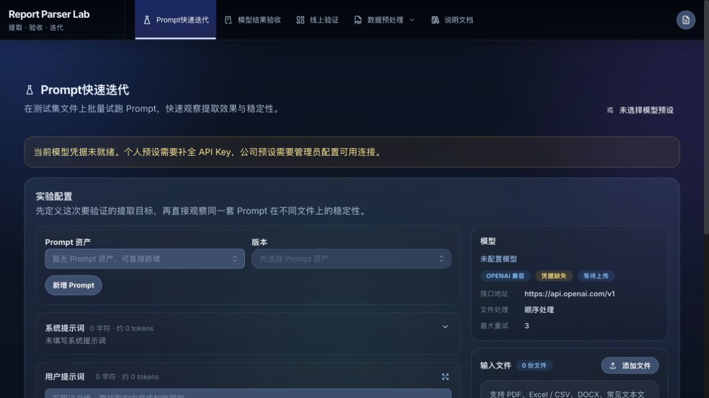
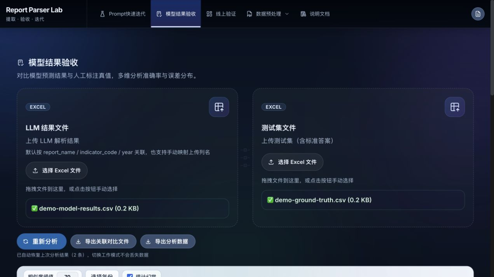
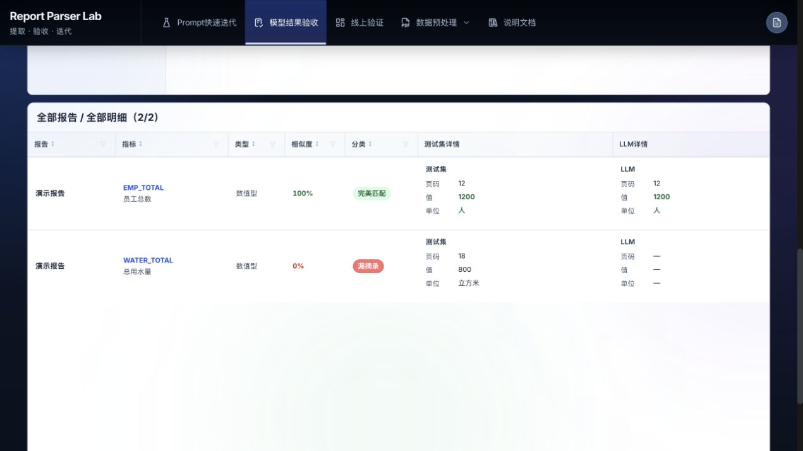

# Report Parser Lab 首版验证

日期：2026-11-12。范围：`report-parser-lab` 的 `1.0.0` 初始快照。本文记录本次检查，不代表所有模型上游和部署环境都已验证。

## 发布内容

- 应用、管理后台、包元数据与 README 统一为 Report Parser Lab，定位为“报告数据提取、结果验收与 Prompt 迭代工作台”。
- 页头使用完整英文项目名与“提取 · 验收 · 迭代”两级文字，桌面导航与品牌分区，窄屏导航独立换行。
- 保留当前提取、验收、Prompt 资产、模型接入和预处理功能；Prompt 自动优化默认关闭。
- 默认新建托管连接使用通用 OpenAI 兼容配置；现有连接的地址和模型继续由部署者配置。
- 移出旧交接、个人复盘与历史验收材料，删除无引用模块及专属样式，清除需求表中的本机路径元数据。
- 提供虚构的 CSV 入门样例、ISC 许可证和 GitHub 测试与构建工作流。
- 更新依赖：Vite 6.4.6、React 插件 4.7.0、Anthropic SDK 0.91.1 及兼容的传递依赖。

## 已完成检查

| 检查 | 方法与结果 |
| --- | --- |
| 自动化测试 | `npm test`：322 项通过，0 失败 |
| 生产构建 | `npm run build`：通过 |
| 干净副本复验 | 不复制 `.env`、服务端数据或旧 Git 历史；`npm ci`、`npm test` 与 `npm run build` 通过 |
| 依赖审计 | `npm audit`：本次检查为 0 个已知漏洞；结果随公告与依赖变化而变化 |
| 文档示例 | 用实际表格解析、关联与评分逻辑验证：员工总数匹配 100 分，用水量未匹配 0 分 |
| 浏览器验收 | 使用隔离的本地测试配置，在生产构建页面上传两份虚构 CSV；显示 1 项完美匹配、1 项漏摘录 |
| 浏览器导出 | 下载关联工作簿，检查工作表与两条样本内容 |
| 页头排版 | 浏览器检查桌面与 390px 手机视口，项目名与副标题各自保持单行，手机页头无横向溢出 |
| 样例保真 | 清除元数据前后，对比两份需求表的工作表名称与全部单元格内容，一致 |
| 发布文件检查 | 检查凭据文件、实际配置中的密钥值、密钥格式、本机路径与历史材料；不纳入发布快照 |

检查截图仅包含虚构样本：

手机页头效果见[手机截图](assets/2026-11-12/header-mobile.jpg)。

## 未覆盖项

本次未使用真实 Key 或真实报告调用外部模型，没有重新验收 PDF 上传提取、扫描件、多模态能力、PDF 压缩与生产反向代理。自动化测试中的公司模型连接使用假 Key 与模拟上游。真实部署应按[部署说明](../deployment.md#验证方式)验证所选服务；默认关闭的自动优化也需单独复验后再开放。
